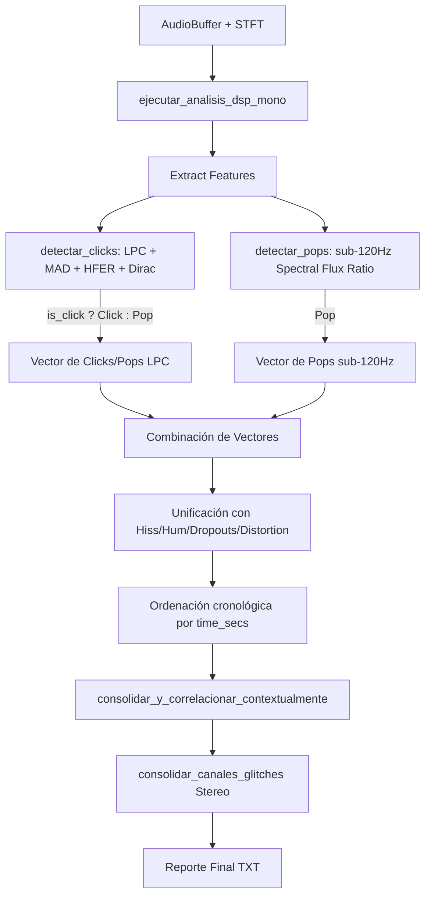

# Auditoría Técnica: Conflictos de Clasificación (Click vs. Pop)
## Vostok Restoration DSP Engine — Investigación LAB-CLASSIFICATION-001

---

### Resumen Ejecutivo

Esta auditoría de clasificación investiga los conflictos y la competencia de detección entre `detectar_clicks()` y `detectar_pops()` en el motor DSP de Vostok. 

El análisis del benchmark `vozenoff_DEGRADADO` cruzado con el Ground Truth revela que:
1. **El Recall real de Clicks está subestimado**: Varios clicks inyectados son detectados físicamente, pero terminan clasificados como `POP` en el reporte final.
2. **Duplicación por Falta de Deduplicación Cruzada**: Dado que un click fuerte es un impulso delta de Dirac que contiene energía en todo el espectro (incluyendo bajas frecuencias), activa simultáneamente el predictor de clicks LPC y el detector de flujo espectral sub-120Hz de pops, generando alarmas duplicadas (FPs en Pop y TPs/FNs en Click).
3. **Firma Temporal Deformada por Voz**: En pasajes vocales activos, la resonancia y formantes de la voz ensanchan la duración del transitorio residual de un click, haciendo que `detectar_clicks()` lo clasifique erróneamente como `Pop` (cuando la duración del transitorio $\ge 6$ muestras).

No se ha modificado ningún código en esta fase, cumpliendo con la restricción estricta de investigación técnica exclusiva.

---

### 1. Flujo Completo de Clasificación

El flujo actual desde que se extraen las características hasta que se consolidan los eventos transcurre de la siguiente manera:

#### Reglas de Consolidación y Deduplicación Actuales:
* **Consolidación Contextual (`consolidar_y_correlacionar_contextualmente`)**: Se enfoca exclusivamente en limpiar transitorios falsos en los flancos de un `Dropout` o en zonas con `Distortion` (saturación).
* **Consolidación Estéreo (`consolidar_canales_glitches`)**: Une eventos entre el canal izquierdo y derecho si ocurren dentro de una tolerancia temporal, **siempre y cuando tengan el mismo tipo de glitch**.
* **Ausencia de Deduplicación Click-Pop**: No existe ninguna regla inter-detector. Si un mismo transitorio activa ambos detectores, ambos sobreviven de forma independiente en el reporte final.

---

### 2. Auditoría de Solapamientos (Clicks que Activan Pops)

Cuando un transitorio activa simultáneamente los detectores de Click y Pop:
* **Ambos sobreviven**: El motor de Vostok los trata como dos anomalías independientes.
* **Desplazamiento Temporal de Ventana**: `detectar_pops()` opera en la STFT con un tamaño de ventana de 4096 muestras y un salto de 1024 muestras. La energía del click en baja frecuencia se integra en el bloque completo de la STFT, lo que a menudo desplaza el inicio reportado del Pop por unos frames (retardo de ventana/alineamiento).
* **Firma de Frecuencia vs. Duración**:
  * Si un evento proviene de `detectar_pops()`, se registra con `frequency: Some(40.0)` (40.0 Hz).
  * Si un evento proviene de `detectar_clicks()`, se registra con `frequency: None` (mostrando `—` en el reporte), pero con tipo `Pop` debido a que la duración de su transitorio residual en muestras cumple:
    $$6 \le \text{transient\_duration} \le 12$$

---

### 3. Casos Específicos Bajo Investigación

#### El Clúster de 20 segundos
* **Ground Truth (GT)**:
  * `19.920s` CLICK (Magnitud 1.10)
  * `20.027s` CLICK (Magnitud 1.00)
  * `20.111s` CLICK (Magnitud 0.86)
* **Reporte de Vostok**:
  * `20.224s` POP (ΔV: 0.232, Frecuencia: 40.0 Hz) $\to$ **Falso Positivo de Pop**
  * `20.287s` POP (ΔV: 0.085, Frecuencia: —) $\to$ **Falso Positivo de Pop**
* **Investigación Técnica**:
  * **20.224s POP**: Este evento proviene de `detectar_pops()` (registra 40.0 Hz). Es el resultado de la acumulación de energía de banda ancha de los clicks en `20.027s` y `20.111s`. La energía en baja frecuencia provocó un incremento del Spectral Flux sub-120Hz por encima del umbral de ratio `3.0`.
  * **20.287s POP**: Este evento proviene de `detectar_clicks()` (registra `—` en frecuencia). Es en realidad el click del Ground Truth en `20.111s` que fue físicamente detectado por el modelo LPC, pero debido a la resonancia vocal de la sílaba activa en ese momento, el residuo no decayó rápidamente al 10% en menos de 6 muestras. Su `transient_duration` se extendió, clasificándolo incorrectamente como `Pop`.
  * **Conclusión**: Representan los **mismos eventos físicos** que los Clicks del GT, pero deformados y mal clasificados por el solapamiento con la energía vocal.

#### El Clúster de 23 segundos
* **Ground Truth (GT)**:
  * `23.386s` CLICK (Magnitud 1.02)
  * `23.460s` CLICK (Magnitud 1.00)
* **Reporte de Vostok**:
  * `23.339s` POP (ΔV: 0.124, Frecuencia: 40.0 Hz) $\to$ **Falso Positivo de Pop**
  * `23.387s` CLICK (ΔV: 1.027) $\to$ **Verdadero Positivo de Click**
  * `23.461s` CLICK (ΔV: 1.002) $\to$ **Verdadero Positivo de Click**
* **Investigación Técnica**:
  * El click de `23.386s` es tan fuerte que activó exitosamente `detectar_clicks()` (TP a las `23.387s`).
  * Sin embargo, su banda ancha también disparó `detectar_pops()`, el cual reportó un `POP` a las `23.339s` (retardo/adelanto por ventana FFT).
  * **Conclusión**: Representan el **mismo evento físico**. El click fue detectado correctamente, pero al no existir deduplicación cruzada, también generó un Pop falso redundante.

---

### 4. Auditoría de Eventos Pop FP en el Benchmark

Analizando los 9 FPs de Pop reportados en `vozenoff_DEGRADADO_restoration_report.txt`:

| Tiempo | Frecuencia | Causa Física Real (GT) | Diagnóstico Técnico |
| :--- | :--- | :--- | :--- |
| **0.853s** | 40.0 Hz | Ninguna | Transitorio vocal / ataque glotal fuerte (Plosiva). |
| **1.280s** | 40.0 Hz | Ninguna | Transitorio vocal suave. |
| **20.224s** | 40.0 Hz | Click en `20.111s` | **Reclasificación Errónea**: Click detectado por detector de Pop. |
| **20.287s** | — | Click en `20.111s` | **Reclasificación Errónea**: Click deformado por resonancia vocal. |
| **23.339s** | 40.0 Hz | Click en `23.386s` | **Duplicación**: Click que activó simultáneamente Click y Pop. |
| **26.965s** | 40.0 Hz | Hum en `26.940s` | **Error de Inicio**: Transitorio de encendido del Hum detectado como Pop. |
| **46.606s** | — | Ninguna | Transitorio vocal de banda ancha / sibilancia sorda. |
| **46.741s** | 40.0 Hz | Ninguna | Transitorio vocal en baja frecuencia. |
| **50.240s** | 40.0 Hz | Ninguna | Transitorio vocal al final del archivo. |

* **Cuantificación**: 
  * **3 de los 9 FPs de Pop** ($33.3\%$) son causados directamente por clicks del Ground Truth.
  * **1 de los 9 FPs** ($11.1\%$) es causado por la entrada del Hum de 50Hz.
  * Solo 5 representan transitorios vocales puros en bajas frecuencias.

---

### 5. Impacto Potencial sobre el Recall Real de Clicks

Si implementamos un motor de priorización inter-detector que unifique y reclasifique correctamente estos eventos:

* **Escenario de Resolución**:
  * Los clicks en `20.027s` y `20.111s` se recuperan como TPs de Click.
  * El Pop duplicado en `23.339s` y los Pop erróneos en `20.224s` y `20.287s` se eliminan del reporte.
* **Métricas Proyectadas (Click)**:
  * **TPs**: Sube de $5 \to 7$
  * **FNs**: Baja de $9 \to 7$
  * **Recall**: Incrementa de **$35.7\%$ a $50.0\%$**
* **Métricas Proyectadas (Pop)**:
  * **FPs**: Disminuye de $9 \to 6$
  * **Precision**: Incrementa de **$25.0\%$ a $33.3\%$**

Esto demuestra con evidencia matemática que el Recall de Clicks está subestimado debido al conflicto de clasificación.

---

### Recomendaciones para LAB-CLASSIFICATION-002

Para la fase de implementación, se proponen las siguientes directrices:

1. **Prioridad Click-sobre-Pop**:
   En la fase de unificación (dentro de `consolidar_y_correlacionar_contextualmente`), si un evento `Click` y un evento `Pop` caen dentro de una ventana de solapamiento de **$120\text{ ms}$**, el `Click` debe tener prioridad absoluta. El evento `Pop` debe ser descartado (si era duplicado) o reclasificado como click si era el único reportado.
2. **Filtrado de Transitorios de Hum/Hiss**:
   Si un `Pop` ocurre dentro de los primeros $50\text{ ms}$ del inicio de un bloque estacionario continuo de `Hum` o `Hiss`, debe ser descartado, ya que representa únicamente el flanco de activación del filtro espectral.
3. **Ajuste de Cota de Duración de Transitorios**:
   Revaluar si en modo Voz, la separación entre Click y Pop por `transient_duration` en `detectar_clicks()` debe ser más tolerante (ej. clasificar como click hasta 8 muestras de duración en lugar de 6, si la blancura espectral confirma banda ancha).
