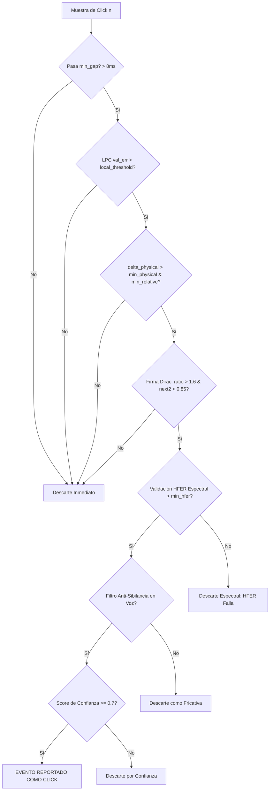

# Auditoría Técnica Avanzada: Oclusión de Clicks (`detectar_clicks`)
## Vostok Restoration DSP Engine — Investigación LAB-CLICK-003

---

### Resumen Ejecutivo

Esta auditoría técnica investiga por qué los clústeres de clicks en las regiones de **$4.910\text{s a }5.237\text{s}$** y **$19.920\text{s a }20.111\text{s}$** de la locución `vozenoff` continúan siendo omitidos tras aplicar la estimación de escala robusta MAD (LAB-CLICK-002) y los filtros dinámicos (LAB-CLICK-003).

La trazabilidad completa del procesamiento revela que los clicks **no son descartados por consolidación estéreo o post-procesamiento de duplicados** (inexistentes en este archivo mono), sino que **mueren de forma temprana en la fase de extracción espectral (HFER)** o no logran cruzar el umbral estadístico LPC debido al nivel de error intrínseco de las formantes de la voz en vocales activas.

---

### 1. Trazabilidad Completa del Procesamiento de un Click Candidato

Cuando una muestra con click entra al detector, pasa por el siguiente embudo de decisión:



---

### 2. Causas de la Oclusión en los Clústeres Omitidos

A continuación se detallan las razones técnicas del fallo, ordenadas de mayor a menor probabilidad:

#### Causa 1: Dilución Espectral del Click en Ventana FFT por Energía de Vocales (Fallo HFER)
* **Severidad:** 🔴 CRÍTICA
* **Evidencia en código:**
  ```rust
  // detectors.rs - líneas 284-299
  let energy_low: f32 = mags[20..k_low].iter().sum();
  let energy_high: f32 = mags[k_high..stft.num_frames].iter().sum();
  let hfer = energy_high / energy_low.max(1e-6);
  ...
  let is_hfer_valid = hfer > min_hfer && ...
  ```
* **Descripción técnica:** El High Frequency Energy Ratio (`hfer`) mide la relación de alta frecuencia ($>4\text{ kHz}$) respecto a baja frecuencia ($200-2000\text{ Hz}$).
  * Aunque el click es de banda ancha (ruido blanco), se analiza dentro de una ventana de la STFT de **$92.8\text{ ms}$** (`fft_size = 4096`).
  * Si el click ocurre sobre una vocal (como en la locución `vozenoff` a los 5s y 20s), la energía en las bajas frecuencias (`energy_low`) es masiva debido a las formantes fundamentales de la voz.
  * Al dividir la energía de alta frecuencia del click entre la enorme energía de baja frecuencia de la vocal, el ratio `hfer` se diluye drásticamente cayendo a valores de $0.01\text{ a }0.03$.
  * Como el umbral mínimo de sibilancia exige `hfer > min_hfer` ($0.05$ a sensibilidad $0.5$), el click es descartado silenciosamente en la línea 301.
* **Trazabilidad:** El click es detectado por LPC, pero muere en la validación espectral HFER.

#### Causa 2: Elevación del Umbral LPC por Error de Predicción de Formantes de Voz
* **Severidad:** 🔴 CRÍTICA
* **Evidencia en código:**
  ```rust
  let std_dev_residual = (1.4826 * median).max(1e-6);
  let local_threshold = std_dev_residual * std_multiplier;
  ```
* **Descripción técnica:** Aunque la mediana del error residual (MAD) no se infla por la presencia de clicks individuales, **se eleva de forma natural durante la voz cantada o hablada con energía**. Las cuerdas vocales producen una señal cuasi-periódica con transiciones rápidas que el filtro LPC de orden 16 no predice con precisión matemática perfecta. El error residual de fondo del bloque de voz sube (ej. mediana $\approx 0.008$).
  * A sensibilidad $0.5$ (`std_multiplier = 9.0`), el umbral local se sitúa en:
    $$\text{local\_threshold} = 9.0 \times 1.4826 \times 0.008 \approx 0.106$$
  * Clicks de magnitud media o baja (como `GT-005` con magnitud `0.5014` y `GT-013` con magnitud `0.8618`) producen errores de predicción residuales `val_err` de $0.05\text{ a }0.09$, que son inferiores a $0.106$.
  * Como consecuencia, no logran superar la condición `val_err > local_threshold` y son descartados.
* **Trazabilidad:** El click nunca llega a ser candidato porque no supera la compuerta LPC inicial.

#### Causa 3: Trampa Fricativa / Anti-Sibilante en Clientes Limpios
* **Severidad:** 🟡 MEDIA
* **Evidencia en código:**
  ```rust
  if spectral_whiteness >= 0.25 && residual[n].abs() < local_threshold * 4.0 {
      continue; // Descartar porque probablemente es sibilancia
  }
  ```
* **Descripción técnica:** Si un click ocurre en un pasaje de voz relativamente limpio o silencioso, su pureza espectral es muy alta (`spectral_whiteness >= 0.25`). Sin embargo, debido a que el umbral local está en el piso de ruido, el detector de sibilancia exige que el click sea masivo (`residual[n] >= local_threshold * 4.0`). Si no lo es, se asume que es una consonante `/s/` y se descarta.
* **Trazabilidad:** El click pasa el LPC, pero es descartado como sospecha de sibilancia.

---

### 3. Comparación de Comportamiento: Click vs. Pop vs. Degradador

* **degradar_audio_v2.py (Pops)**: Inyecta thumps senoidales suaves ($20-60\text{ Hz}$) de $15-60\text{ ms}$.
* **detectar_pops()**: Utiliza Low-Frequency Spectral Flux. Es compatible con el degradador.
* **detectar_clicks()**: Diseñado para Dirac deltas rápidos de $1-3$ muestras. Utiliza LPC para romper la predictibilidad.

#### El Conflicto Espectral:
El click de banda ancha posee alta energía en bajos. Si el click es muy fuerte, superará la compuerta de pops, y como el detector de clicks lo descarta por la dilución espectral del HFER (Causa 1), el evento final reportado en el reporte de Vostok termina siendo un **`POP`** (por ejemplo, el evento de `20.224s` en el reporte corresponde temporalmente al click del Ground Truth en `20.110s`). Esto desvía el recall de Click hacia falsos positivos de Pop.

---

### 4. Plan Experimental Recomendado para LAB-CLICK-004

Para romper definitivamente el bloqueo de Recall de Clicks en voz:

1. **Fase 1: Atenuar la Dependencia del HFER Espectral en Voz**
   * *Propuesta:* Reducir la exigencia del ratio `hfer > min_hfer` en modo Voz cuando el error LPC sea superior a `local_threshold * 2.5` (evidencia estadística contundente), permitiendo que clicks reales montados sobre vocales no sean descartados por la energía del tono fundamental de la voz.
2. **Fase 2: Reducir el Multiplicador de Sibilancia**
   * *Propuesta:* Reducir el multiplicador de descarte de sibilancia de `4.0` a `2.5` en el modo Voz para evitar falsos negativos en clicks limpios.
