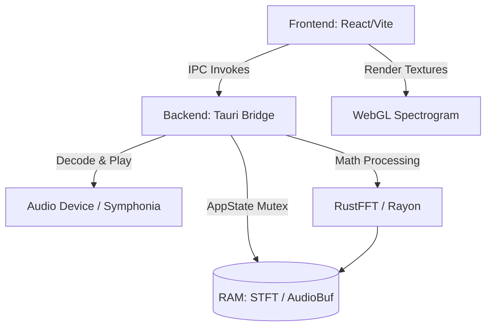

# DOC-005: Codebase Responsibility Map

Este documento sirve como un mapa de navegación técnica rápida para el onboarding de futuros investigadores DSP y Agentes IA dentro del ecosistema **Vostok Restoration V1**.

---

## `src-tauri/src/dsp.rs`
* **Responsabilidad**: 
  Núcleo de algoritmos de procesamiento de señales digitales (DSP). Encargado de transformar el audio de dominio del tiempo a dominio de frecuencia usando Transformadas Rápidas de Fourier (STFT). También alberga los métodos de estimación de "noise floor".
* **Qué NO modificar sin investigación previa**: 
  * Las ventanas "hann" y sus solapamientos (hop_size/fft_size).
  * Estructuras de iteración con `rayon::par_chunks` (puede causar carreras de datos sutiles o degradación de rendimiento si se altera el particionamiento de hilos).
* **Dependencias**: `rustfft`, `rayon`.
* **Riesgo de modificación**: **Crítico**

---

## `src-tauri/src/lib.rs`
* **Responsabilidad**: 
  Puente de Inter-Process Communication (IPC) con Tauri y gestor del Estado Global en RAM. Almacena de forma concurrente el `AudioBuffer` completo, la `AnalyticalSpectrogram`, y controla el engine de reproducción de `rodio`.
* **Qué NO modificar sin investigación previa**: 
  * La estructura `SafeOutputStream` que sortea los strict `Send + Sync` requirimientos de Rust en Windows/WASAPI.
  * El orden de adquisición de locks (`.lock().unwrap()`) en los mutex de `AppState`. Un orden incorrecto puede causar **Deadlocks** irrecuperables en la UI.
* **Dependencias**: `tauri`, `rodio`, módulos locales `dsp.rs`.
* **Riesgo de modificación**: **Alto**

---

## `src-tauri/src/dsp_recovered.rs` (y algoritmos de parcheo)
* **Responsabilidad**: 
  Módulos experimentales o iterativos encargados de la localización específica de anomalías (glitches, drops) y su eventual reconstrucción algorítmica.
* **Qué NO modificar sin investigación previa**: 
  * Los umbrales *hardcoded* o funciones de densidad de probabilidad para la detección.
* **Dependencias**: Funciones matemáticas puras del DSP base.
* **Riesgo de modificación**: **Alto**

---

## `src/components/VostokRestoration.jsx`
* **Responsabilidad**: 
  God Object / Workspace Principal. Orquesta el estado de todo el cliente, controla la línea de transporte (Play/Stop), mantiene las coordenadas del viewport de zoom y emite los comandos IPC a Rust cada vez que cambia la vista.
* **Qué NO modificar sin investigación previa**: 
  * La cadencia y el `useCallback` de `handleViewportChange`. Modificar las optimizaciones de llamadas IPC o los *debounces* podría saturar el puente y congelar la aplicación.
* **Dependencias**: React hooks, `lucide-react`, API de Tauri.
* **Riesgo de modificación**: **Alto**

---

## `src/components/SpectrogramGL.jsx`
* **Responsabilidad**: 
  Transformar las tramas serializadas (arrays Uint8 o Base64) en texturas de 2 dimensiones usando WebGL1/2 puro. Renderiza el Log-Spectrogram a 60FPS constantes en hardware.
* **Qué NO modificar sin investigación previa**: 
  * Los shaders GLSL (`vertexShaderSource`, `fragmentShaderSource`).
  * Los métodos de vinculación de texturas `gl.texImage2D`. Cambiar el alineamiento de bytes destruirá la renderización de la matriz.
* **Dependencias**: WebGL standard API, React ref.
* **Riesgo de modificación**: **Medio/Alto**

---

## `src/components/GlitchPanel.jsx`
* **Responsabilidad**: 
  Listado e interacción humana con los artefactos detectados en el archivo. Permite navegar (seek) hacia cada error y activar simulaciones o reparaciones algorítmicas visuales.
* **Qué NO modificar sin investigación previa**: 
  * Los índices de selección correlativos al array de detección crudo que se pasa por props.
* **Dependencias**: Contexto principal de la sesión en `VostokRestoration.jsx`.
* **Riesgo de modificación**: **Bajo**

---

## Configuración y Build (`package.json`, `Cargo.toml`, `vite.config.js`)
* **Responsabilidad**: 
  Orquestar el ecosistema y agrupar las bibliotecas.
* **Qué NO modificar sin investigación previa**: 
  * El target flag de Tauri en Vite o los features habilitados de `symphonia` en Cargo. Activar todos los decodificadores incrementa el tamaño del binario y tiempos de compilación.
* **Dependencias**: N/A.
* **Riesgo de modificación**: **Bajo**

---

## Diagrama Textual de Dependencias (Macro)

*(Generado por Vostok AI Architect).*
