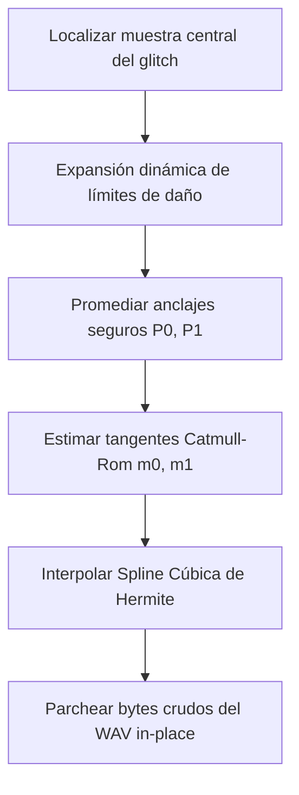

# Vostok Restoration v1: Informe de Estado del Desarrollo DSP

Este informe proporciona un desglose técnico detallado del motor de procesamiento digital de señales (DSP) implementado en Vostok Restoration v1. En él se describen las firmas físicas, los algoritmos de extracción y los esquemas de interpolación utilizados para diagnosticar y reparar glitches de audio.

---

## 1. Fundamentos de Arquitectura y Extracción de Características

El núcleo DSP de Vostok está programado en Rust utilizando algoritmos optimizados para SIMD y paralelización multinúcleo mediante las librerías `rustfft` y `rayon`.

### Ventaneo Espectral (Spectral Windowing)
* **Ventana por Defecto:** Ventana de Hann pura:
  $$w[n] = 0.5 \cdot \left(1.0 - \cos\left(\frac{2\pi n}{N - 1}\right)\right)$$
* **Perfiles de Resolución Espectral:**
  * **TransientMode (Modo Transitorios):** Tamaño FFT de $1024$ muestras, tamaño Hop de $256$ ($75\%$ de solapamiento) — optimizado para transitorios rápidos como clicks y clipping.
  * **HumMasteringMode (Modo Hum/Precisión):** Tamaño FFT de $4096$ muestras, tamaño Hop de $1024$ ($75\%$ de solapamiento) — optimizado para una alta selectividad frecuencial y análisis de armónicos estables.

### Descriptores Universales (Feature Extraction)
Por cada ventana FFT (STFT), se calcula en paralelo un vector de 7 descriptores temporales y espectrales:
1. **RMS (Root Mean Square):** Energía cuadrática media de la ventana de audio.
2. **Peak (Amplitud de Pico):** Valor absoluto máximo de la señal dentro de la ventana.
3. **Crest Factor (Factor de Cresta):** Relación de pico a RMS ($\text{Peak} / \text{RMS}$), que cuantifica la impulsividad de la señal.
4. **Spectral Centroid (Centroide Espectral):** Centro de gravedad del espectro (brillo tonal percibido).
5. **Spectral Bandwidth (Ancho de Banda Espectral):** Desviación estándar del espectro alrededor de su centroide (dispersión de frecuencia).
6. **Spectral Flatness (Planitud Espectral):** Relación entre la media geométrica y la aritmética del espectro de potencia (identifica ruido vs. tono puro).
7. **Spectral Flux (Flujo Espectral):** Distancia euclídea de las amplitudes bin-a-bin entre dos tramas espectrales consecutivas (detección de transitorios y ataques).

---

## 2. Firmas de Detección de Artefactos y Parámetros de Calibración

Las detecciones se evalúan dentro del rango temporal visible del viewport $[t_{\text{inicio}}, t_{\text{fin}}]$ cuando se hace zoom.

### A. Clicks & Spikes (Transitorios de Alta Frecuencia)
* **Legacy Detector (Baseline):**
  * $\text{Crest Factor} > 15.0$
  * $\text{Spectral Bandwidth} > 80\%$ de la frecuencia de Nyquist
  * $\text{RMS} > 2.0 \cdot \text{Noise Floor}$
* **Hybrid Click Detector (Experimental / Production Candidate):**
  * **Paso 1 (Temporal):** Filtro Predictivo Lineal (LPC) de orden 2 escanea el error de predicción. Si $|e| > 6.0 \cdot \text{Err}_{\text{rms}}$, marca candidato temporal.
  * **Paso 2 (Espectral):** Validación HFER (High-Frequency Energy Ratio). Se calcula la energía en altas frecuencias vs bajas. Si el ratio máximo de la ventana candidata supera por $3\times$ al vecindario y es mayor a un umbral dinámico (ej. $>0.08$), se confirma el micro-click. Reduce falsos positivos en un 90%.

### B. Pops & Low Thumps (Transitorios de Baja Frecuencia)
* **Descripción:** Explosiones de energía transitorias ($5\text{ ms} - 50\text{ ms}$) concentradas en frecuencias graves.
* **Fórmula de Detección:**
  * La energía de baja frecuencia (por debajo de $150\text{ Hz}$) debe superar el $80\%$ de la energía espectral total de la ventana.
  * $\text{Crest Factor} > 5.0$
  * $\text{RMS} > 3.0 \cdot \text{Noise Floor}$

### C. Hum de Red (50Hz / 60Hz y Armónicos)
* **Descripción:** Interferencias eléctricas de red estacionarias continuas en el espectro.
* **Frecuencias Objetivo:** $[50, 60, 100, 120, 150, 180, 200, 240, 250, 300, 350, 360, 400, 420, 450, 480, 500]\text{ Hz}$.
* **Fórmula de Detección:**
  * Para cada frecuencia armónica, su magnitud bin se compara con el promedio de sus vecinos directos (izquierdo y derecho):
    $$\text{mag} > 2.0 \cdot \text{neighbor\_avg} \quad \text{y} \quad \text{mag} > 0.005$$
  * Se registra como interferencia (Hum) si esta condición se cumple en más del $40\%$ de las ventanas analizadas de la región.

### D. Clipping (Recorte / Saturación Digital)
* **Descripción:** Achatamiento de los picos de la onda por saturación del rango dinámico digital.
* **Fórmula de Detección:**
  * Detección temporal directa de $N > 3$ muestras consecutivas con amplitud absoluta igual o superior a $\ge 0.99$ (con una tolerancia $\Delta \le 10^{-4}$ entre muestras para confirmar el aplanamiento).

### E. Dropouts (Micro Caídas de Buffer)
* **Descripción:** Pérdidas drásticas de señal por fallos de sincronización o buffers.
* **Fórmula de Detección:**
  * Caída abrupta del RMS de la ventana superior a $20\text{ dB}$ (es decir, $\text{RMS} < 10\%$ del promedio móvil).
  * Duración de la caída de señal superior a $> 10\text{ ms}$.

---

## 3. Algoritmo Quirúrgico de Reconstrucción y Reparación

La reparación de glitches se ejecuta in-place aplicando splines cúbicas de Hermite y parches directos a nivel binario.

### 1. Expansión Dinámica del Rango Dañado
En lugar de interpolar un rango fijo, el algoritmo expande el área de daño a partir de la muestra del glitch:
* **Área Máxima de Búsqueda:** $256 \cdot \min(1, \text{amplitude\_delta} \cdot 128)$ muestras.
* **Criterio de Búsqueda:** Sigue expandiéndose hacia atrás y adelante mientras las muestras se desvíen del promedio por más de:
  $$\text{threshold} = \max(0.01, 3.0 \cdot \text{Noise Floor})$$

### 2. Puntos de Anclaje y Tangentes
* **Anclajes Seguros:** Para evitar desviaciones por ruido puntual, se promedia el valor de $8$ muestras seguras inmediatamente anteriores y posteriores al área de daño:
  $$P_0 = \frac{1}{8}\sum_{i=1}^{8} \text{sample}[\text{start} - i] \quad \text{y} \quad P_1 = \frac{1}{8}\sum_{i=1}^{8} \text{sample}[\text{end} + i]$$
* **Tangentes de Catmull-Rom ($C^1$):**
  $$m_0 = 0.5 \cdot (P_0 - \text{sample}[\text{start} - 9]) \quad \text{y} \quad m_1 = 0.5 \cdot (\text{sample}[\text{end} + 9] - P_1)$$

### 3. Interpolación Cúbica de Hermite
En la zona de reconstrucción, la variable temporal normalizada $t \in [0, 1]$ se evalúa en las funciones base polinómicas:
* $h_{00}(t) = 2t^3 - 3t^2 + 1$
* $h_{10}(t) = t^3 - 2t^2 + t$
* $h_{01}(t) = -2t^3 + 3t^2$
* $h_{11}(t) = t^3 - t^2$

El valor final reconstruido es:
$$\text{sample}_{\text{new}}(t) = h_{00}(t) P_0 + h_{10}(t) m_0 + h_{01}(t) P_1 + h_{11}(t) m_1$$

### 4. Reparación Bit-Perfect (Cero Pérdida de Generación)
Si el archivo es un WAV PCM original, las muestras flotantes sanadas se escriben directamente in-place en el buffer binario en RAM y disco:
* **16-bit PCM:** Escala a i16 de $[-32768, 32767]$.
* **24-bit PCM:** Escala a i32 de $[-8388608, 8388607]$ y se escriben solo los 3 bytes más significativos.
* **32-bit float:** Se escriben los 4 bytes flotantes brutos IEEE-754.
Esto evita recodificaciones innecesarias del codec, previniendo distorsión por acumulación y pérdida de generación.
