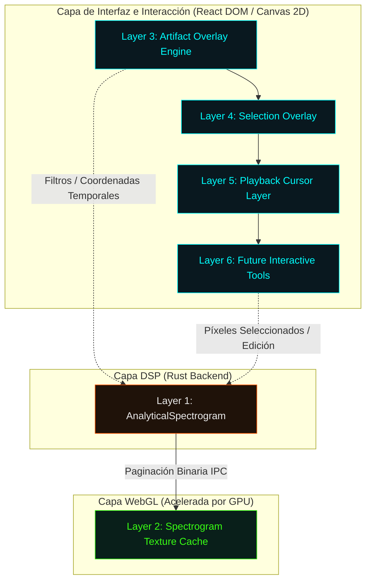

# INFRA-005: Spectrogram Rendering Architecture Refactor

Este documento define la arquitectura objetivo de renderizado espectral para **Vostok Restoration V1**, diseñada para erradicar el cuello de botella en el bridge IPC y la sobrecarga de CPU/GPU al interactuar con el espectrograma, garantizando la preservación científica del `AnalyticalSpectrogram` como Fuente de Verdad.

---

## 1. Pila de Arquitectura Desacoplada (6-Layer Spectrogram Stack)

Para aislar el procesamiento matemático de la interacción en pantalla a 60 FPS, se propone dividir la vista del espectrograma en seis capas independientes con responsabilidades estrictamente delimitadas:



---

## 2. Responsabilidades y Ciclo de Vida de las Capas

| Capa | Qué Almacena | Quién la Actualiza | Cuándo se Invalida | Eventos que la Afectan |
| :--- | :--- | :--- | :--- | :--- |
| **Layer 1: AnalyticalSpectrogram** | Matriz bidimensional de magnitudes de STFT (`Vec<f32>`), fases y persistencias calculadas en Rust. | Backend DSP (Rust). | Carga de archivo WAV, cambio de perfil de resolución o al aplicar una reparación local. | `LOAD_FILE`, `SWAP_PROFILE`, `COMMIT_REPAIR`. |
| **Layer 2: Spectrogram Texture Cache** | Mosaico de texturas en VRAM (GPU) y coordenadas de visualización correspondientes al viewport actual + márgenes de búfer. | Contexto WebGL (`SpectrogramGL.jsx`) vía chunks binarios del IPC. | Modificación física del audio (mutación de Layer 1) o al hacer zoom fuera de los límites de resolución del Mipmap actual. | `VIEWPORT_ZOOM_LIMIT`, `STFT_MUTATED`. |
| **Layer 3: Artifact Overlay Engine** | Coordenadas temporo-frecuenciales de glitches detectados (rectángulos, confianzas y clasificaciones). | Componentes React (`GlitchPanel.jsx` / Canvas 2D) a partir del JSON de detección. | Cambios de sensibilidad (threshold), alternancia de filtros (clicks, pops, hum, dropouts) o reparación de glitches. | `THRESHOLD_UPDATED`, `FILTER_TOGGLED`, `REPAIR_COMPLETED`. |
| **Layer 4: Selection Overlay** | Límites de selección del usuario en tiempo (segundos) y frecuencia (Hz) para reparaciones dirigidas. | Eventos del ratón/gestos en el Frontend. | Movimiento del ratón durante el arrastre o al hacer clic de cancelación. | `MOUSE_DOWN`, `MOUSE_MOVE`, `MOUSE_UP`, `CLEAR_SELECTION`. |
| **Layer 5: Playback Cursor Layer** | Posición en segundos del cursor de reproducción de audio. | Animación del Frontend sincronizada con `rodio` (`requestAnimationFrame` a 60 FPS). | Cada tick del reloj de reproducción. | `PLAYBACK_TICK`, `PLAYBACK_START`, `PLAYBACK_STOP`. |
| **Layer 6: Future Interactive Tools** | Pinceles, borradores de frecuencias y visualizadores de herramientas de edición espectral manual. | Eventos de dibujo de cursor del usuario. | Durante el arrastre de herramientas interactivas. | `TOOL_SWAP`, `DRAW_STROKE`. |

---

## 3. Estrategia de Caché: Tiled Texture Cache con Mipmaps

Para archivos de audio extensos (ej. 30 a 60 minutos), es inviable subir toda la STFT analítica a la GPU debido a restricciones de VRAM y al límite físico de dimensiones de textura WebGL (`max_texture_width`, comúnmente 2048 o 4096 px). 

### Solución Arquitectónica
Se implementará un sistema de **Tiled Texture Cache con Mipmaps**:
1. **Tiles Temporales (Mosaicos):** El espectrograma se segmenta en bloques de tiempo fijos (ej. bloques de 5 segundos de audio a la resolución nativa).
2. **LRU Cache en VRAM:** El frontend mantiene en la GPU solo los tiles visibles en pantalla más un tile de búfer a la izquierda y derecha para garantizar transiciones suaves de scroll. Los tiles antiguos se descartan usando un algoritmo de *Least Recently Used* (LRU).
3. **Mipmaps (Pirámide de Frecuencias):** Para visualizaciones de zoom macro (donde un píxel representa múltiples frames de STFT), el backend computará versiones pre-downsampleadas de los tiles (ej. niveles de resolución $1\times$, $1/2\times$, $1/4\times$, $1/8\times$). Esto elimina el aliasing y ahorra un 75% de datos de transferencia por cada nivel de zoom inferior.

---

## 4. Zoom y Pan en GPU (Bypass de IPC)

En el sistema actual, cada movimiento de zoom o paneo invoca `obtener_espectrograma_visible`, disparando un recálculo de downsampling y una transferencia base64 masiva.

### Solución Arquitectónica
*   **Micro y Moderado Zoom/Pan (60 FPS):** El arrastre y la rueda de zoom se resuelven **exclusivamente en la GPU** a través del Vertex Shader, modificando las coordenadas de textura proyectadas y la matriz de proyección ortográfica. La UI responde instantáneamente sin latencia de IPC.
*   **Macro Zoom/Pan (Debounced IPC):** Solo cuando el usuario desplaza la vista fuera de los tiles cargados en caché o supera el umbral de resolución de un Mipmap, se dispara una llamada de IPC asíncrona y debendeada (150ms) para traer nuevos tiles de Rust.

---

## 5. Segregación de Overlays

### Justificación Técnica
*   **Desacoplamiento de Playhead:** El cursor de reproducción se actualiza a 60 Hz. Si formase parte de la textura de WebGL, obligaría a reconstruir y subir a la GPU 2.7 MB de datos en cada frame de reproducción. Al renderizarse en un **Canvas 2D transparente superpuesto** (Layer 5), el costo de CPU/GPU de mover la aguja pasa de ser masivo a virtualmente cero ($O(1)$).
*   **Vectorización de Glitches (Layer 3):** Los glitches detectados se renderizan como objetos vectoriales sobre un Canvas 2D/SVG superpuesto. Esto permite glows ("Noir-Tech" Glassmorphic glow usando `shadowBlur`) y cajas interactivas con eventos `hover` nativos de HTML, independientes de la resolución del canvas de WebGL.

---

## 6. Estrategia de Actualización e Invalidadación Parcial

Cuando se ejecutan acciones específicas en la sesión, la cascada de actualizaciones se mitiga de la siguiente manera:

1.  **Cambio de Sensibilidad (Slider Confidence / Threshold):**
    *   *Backend:* Ejecuta `detect_artifacts_dynamic` sobre el `AnalyticalSpectrogram` (Layer 1) que permanece inmutable en RAM.
    *   *IPC:* Transmite únicamente un array JSON con las coordenadas e IDs de los nuevos glitches válidos (tamaño < 10 KB).
    *   *Frontend:* Invalida y redibuja **únicamente Layer 3 (Artifact Overlay)**. Las texturas espectrales de GPU (Layer 2) no se alteran.
2.  **Modificación de Selección:**
    *   *Frontend:* Invalida y redibuja **únicamente Layer 4 (Selection Overlay)** resolviéndose a nivel de coordenadas 2D. Cero impacto en el resto de la app.

---

## 7. Reparaciones Quirúrgicas Localizadas y de Bajo Costo

Actualmente, aplicar una reparación implica recargar todo el audio, recalcular toda la STFT y reconstruir la vista visual entera.

### Arquitectura de Actualización Quirúrgica
1.  **Recálculo STFT Localizado:** Si el usuario repara una región dañada entre el sample $N_0$ y $N_1$ (ej. una ventana de 100ms), el backend de Rust calcula los frames de STFT *únicamente* para esa vecindad temporal en memoria RAM:
    $$\text{Rango Frames} = \left[ \frac{N_0 - \text{window\_size}}{\text{hop\_size}}, \frac{N_1 + \text{window\_size}}{\text{hop\_size}} \right]$$
2.  **Inyección Parcial de Textura (texSubImage2D):** El backend envía al frontend únicamente el búfer binario de los frames mutados. El renderizador WebGL utiliza la función optimizada de OpenGL:
    ```javascript
    gl.texSubImage2D(gl.TEXTURE_2D, 0, xOffset, 0, width, height, gl.LUMINANCE, gl.UNSIGNED_BYTE, subData);
    ```
    Esto parchea "in-place" el mosaico de textura en la VRAM de la GPU en microsegundos, evitando re-renderizar o transferir el 99% restante del audio.

---

## 8. Optimización del Canal IPC: Bypass de Base64

El bridge de Tauri actual serializa la matriz STFT como un string Base64. Esto añade un overhead de tamaño del 33% e introduce latencias pesadas debido a la decodificación de strings en el Web Worker o el hilo principal.

### Solución Arquitectónica
*   **Binary IPC Responses:** Los comandos de Tauri devolverán respuestas binarias directas utilizando la representación de `tauri::ipc::Response` cargada con un vector crudo de bytes (`Vec<u8>`).
*   **Transferencia Directa de Memoria:** En el frontend, el binario cruza el bridge como un `ArrayBuffer` nativo (sin coste de conversión). Este búfer se inyecta directamente a la GPU:
    ```javascript
    gl.texImage2D(gl.TEXTURE_2D, 0, gl.LUMINANCE, width, height, 0, gl.LUMINANCE, gl.UNSIGNED_BYTE, new Uint8Array(arrayBuffer));
    ```

---

## 9. Roadmap de Migración Técnica (Phased Roadmap)

### Fase 1: Desacoplamiento de Overlays y Cursor (Bajo Riesgo / Alto Impacto)
*   **Objetivo:** Eliminar re-renderizados causados por el playhead y selecciones.
*   **Acciones:**
    *   Extraer la lógica del playhead y la selección de `SpectrogramGL.jsx`.
    *   Crear componentes React superpuestos transparentes (`PlaybackCursorCanvas.jsx` y `InteractionOverlay.jsx`) posicionados con CSS absoluto exactamente sobre el WebGL canvas.

### Fase 2: Implementación de Canal IPC Binario (Optimización de Datos)
*   **Objetivo:** Remover serialización Base64.
*   **Acciones:**
    *   Modificar `obtener_espectrograma_visible` en `lib.rs` para retornar un buffer binario crudo `Vec<u8>` en lugar de `PagedStftResult` serializado en JSON con Base64.
    *   Actualizar `VostokRestoration.jsx` para invocar comandos binarios de Tauri v2 y pasar el búfer al componente WebGL de forma directa.

### Fase 3: Introducción del Texture Cache Mosaico (Tiling) en WebGL
*   **Objetivo:** Permitir soporte para audios de larga duración y zoom fluido a 60 FPS en GPU.
*   **Acciones:**
    *   Ajustar el shader de WebGL para soportar offsets de coordenadas de textura dinámicas controladas por el Vertex Shader.
    *   Implementar el LRU Cache en React/JS para gestionar los ID de textura WebGL activos en la GPU.

### Fase 4: Parcheo Quirúrgico In-Place
*   **Objetivo:** Hacer que el tiempo de guardado y previsualización de reparación sea menor a 15ms.
*   **Acciones:**
    *   Refactorizar `aplicar_reparacion_quirurgica` en `lib.rs` para devolver únicamente el recorte de STFT modificado.
    *   Integrar `gl.texSubImage2D` en `SpectrogramGL.jsx` para inyectar selectivamente las correcciones.

---

*(Documento de Ingeniería de Vostok Labs - Propuesta de Arquitectura de Refactorización).*
