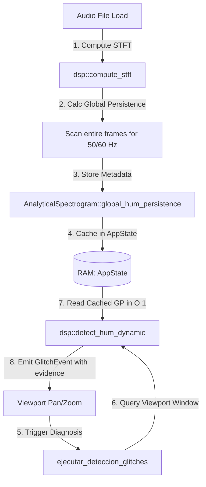

# PROD-004A: Hum Integration Architecture Revision

Este documento detalla la resolución de los conflictos de integración identificados entre el análisis espectral local (Viewports) y las métricas de **Global Persistence** validadas por el laboratorio en **INV-003D**.

---

## 1. Resolución de Conflictos Espectro-Temporales

El principal problema es que **Global Persistence** requiere analizar el archivo completo, mientras que el pipeline de diagnóstico de producción (`ejecutar_deteccion_glitches`) procesa rebanadas locales de tiempo. Escanear la matriz completa en cada consulta del Viewport destruiría el rendimiento y violaría los principios de aislamiento de **DOC-004** y **DOC-005**.

### Solución Arquitectónica
Calcular la persistencia global **una sola vez** al generar el espectrograma (en `compute_stft`), almacenar el resultado como metadatos indexados dentro del struct `AnalyticalSpectrogram`, y consumirlos en $O(1)$ durante el diagnóstico de los viewports locales.



---

## 2. Respuestas a Preguntas Arquitectónicas (Preguntas A → E)

### Pregunta A: ¿Dónde debería almacenarse Global Persistence?
**Recomendación:** **Opción 2: `AnalyticalSpectrogram`**.
* **Justificación**: El espectrograma es la fuente de verdad del comportamiento espectro-temporal del archivo. Almacenar el mapa de persistencia de fundamentales (`global_hum_persistence: HashMap<u32, f32>`) dentro de este struct mantiene los metadatos acoplados a la matriz de magnitudes. Si el usuario recalcula el espectrograma con otro perfil de resolución, los metadatos se actualizan automáticamente de forma consistente.

### Pregunta B: ¿Cuándo debe calcularse Global Persistence?
**Recomendación:** **Al generar el espectrograma (`dsp::compute_stft`)**.
* **Justificación**: El espectrograma se calcula en un hilo secundario de `spawn_blocking` (usando `rayon` en paralelo) al cargar el archivo o cambiar el perfil. Añadir una pasada lineal preliminar sobre las magnitudes de las columnas para los bins de 50Hz/60Hz añade un overhead insignificante ($<5\text{ ms}$ en archivos de 1 hora) frente al cómputo de las FFTs, eliminando la necesidad de realizar costosos barridos redundantes en consultas subsiguientes de zoom o pan.

### Pregunta C: Integración en `DetectorThresholds`
Los parámetros descubiertos en **INV-003D** deben existir explícitamente en `DetectorThresholds` para evitar constantes *hardcoded* y cumplir con **AF-004** (exponer límites físicos al usuario).
* **Nuevos Campos**:
  ```rust
  pub struct DetectorThresholds {
      ...
      pub hum_cv_threshold: f32,            // Por defecto: 0.1
      pub hum_harmonic_decay_max: f32,     // Por defecto: 0.8
      pub hum_global_persistence_min: f32, // Por defecto: 0.05
  }
  ```

### Pregunta D: Exposición en `GlitchEvent`
**Recomendación:** **Deben exponerse como Telemetría en el campo `evidence`**.
* **Justificación**: En consonancia con el diseño *Noir-Tech* y el hallazgo **AF-007**, el usuario debe tener visibilidad del comportamiento físico detectado. Al añadir un campo opcional `evidence: Option<String>` a `GlitchEvent`, podemos propagar un string serializado en JSON con los datos específicos (ej: `{"cv": 0.003, "decay": 0.45, "global_presence": 0.82}`). Esto permite a la interfaz pintar descripciones precisas sin sobrecargar la estructura de datos común.

### Pregunta E: Consolidación de Armónicos de Hum
**Recomendación:** **La consolidación en un único evento de fundamental (50Hz / 60Hz) es la correcta**.
* **Justificación**: El Hum de red es un único agente parásito continuo. Reportar cada armónico individualmente (100Hz, 150Hz, 200Hz...) como glitches independientes abruma visualmente al usuario y dificulta la reparación. La reparación se realiza aplicando filtros Notch o Comb sobre la serie armónica completa. El evento principal debe ser el de la fundamental (ej. `"HUM (50 Hz)"`), conteniendo la lista de armónicos activos en sus metadatos de evidencia.

---

## 3. Cambios Mínimos Necesarios para Implementación

### 1. `src-tauri/src/dsp.rs`
* Añadir `global_hum_persistence: std::collections::HashMap<u32, f32>` a `AnalyticalSpectrogram`.
* Modificar `compute_stft` para calcular y rellenar este mapa.
* Expandir `DetectorThresholds` con `hum_cv_threshold`, `hum_harmonic_decay_max` y `hum_global_persistence_min`.
* Añadir el campo opcional `evidence: Option<String>` a `GlitchEvent`.
* Reescribir `detect_hum_dynamic` para que:
  1. Extraiga la persistencia global en $O(1)$ de `stft.global_hum_persistence`.
  2. Filtre bins candidatos por $CV < hum_cv_threshold$.
  3. Mida el decaimiento de armónicos $Decay < hum_harmonic_decay_max$.
  4. Genere el `GlitchEvent` con su `confidence` calculada y el JSON en `evidence`.

### 2. `src-tauri/src/lib.rs`
* No requiere cambios en firmas de comandos. Asegura la serialización correcta del campo `evidence` en los handlers de Tauri.

### 3. Frontend UI (`VostokRestoration.jsx` / `GlitchPanel.jsx`)
* El inspector de glitches leerá e interpretará el campo `evidence` de los ítems de tipo `HUM` para mostrar telemetría formateada (ej. `CV: 0.002 | decay: 0.4`).

---

## 4. Matriz de Riesgos Detectados

* **Riesgo Espectral en Audios Cortos (Bajo)**: En archivos de $< 2$ segundos, la persistencia global puede ser ruidosa. *Mitigación*: Desactivar el filtro de persistencia global si `total_frames` es menor que un threshold crítico (ej. $< 100$ frames).
* **Consumo de Memoria de Telemetría (Bajo)**: Serializar metadatos en strings añade overhead en IPC. *Mitigación*: Mantener el string corto, omitiendo claves innecesarias para no-hum events.

---
*(Generado por Antigravity Vostok Architect - Revisión de Arquitectura Hum).*
