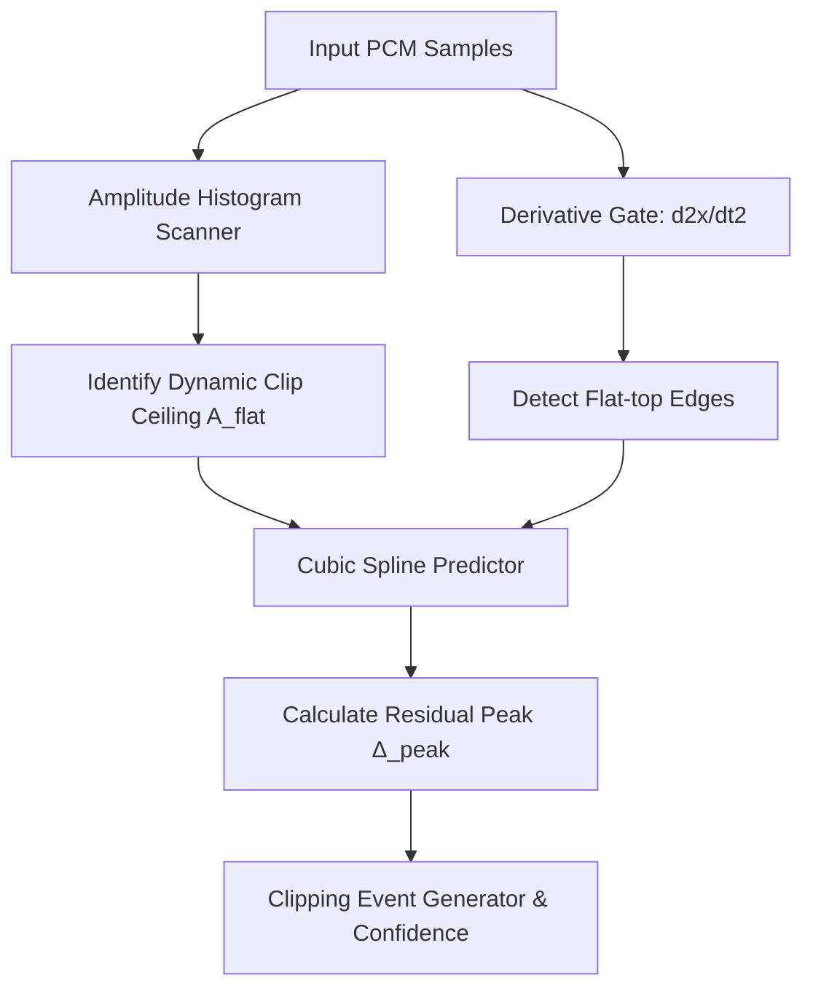
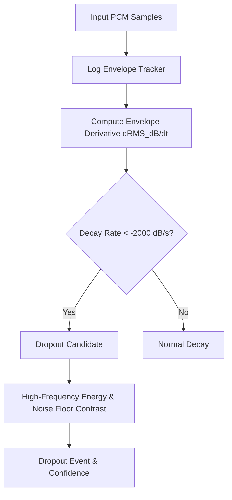
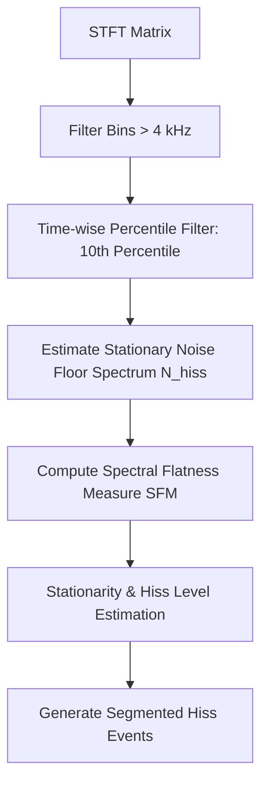

# Vostok Labs: Technical Specification (PROD-005)
## Advanced Detection Algorithms for Clipping, Dropouts, and Hiss

This document details the mathematical models, algorithmic steps, and software architecture to implement high-performance, low-false-positive detection for digital clipping, signal dropouts, and stationary high-frequency hiss within the Rust/Tauri DSP core (`dsp.rs`).

---

### 1. Advanced Clipping Detection

#### Limitations of the Current Algorithm
The legacy detector checks if the absolute sample value is at or above a hardcoded limit (e.g., $0.999$). It fails when:
1. The clipped audio was subsequently attenuated or normalized downwards (e.g., maximum peak at $0.85$, but flattened).
2. Natural digital square waves (synthesizers) are flagged as clipping events.

#### Proposed Architecture
To detect true clipping dynamically, we combine three indicators: **amplitude histograms**, **derivative gates**, and **cubic spline reconstruction residuals**.



##### 1. Dynamic Ceiling Detection via Histogram
Instead of a fixed threshold, we scan the absolute sample amplitudes and build a histogram $H(A)$ with 1024 bins:
* A digital signal that was clipped and then scaled down by factor $g$ will exhibit a sharp spike in $H(A)$ at $A_{\text{flat}} = g$ followed by an immediate drop to zero for $A > g$.
* If a significant peak is found at $A_{\text{flat}} \ge 0.5$ containing more than 0.05% of the total samples, we set the clipping threshold dynamically to $T_{\text{clip}} = A_{\text{flat}} - \epsilon$.

##### 2. Edge Detection via Derivative Gate
Clipped waveforms transition instantly from curved trajectories to a slope of exactly zero (flat-top). We analyze the forward difference (slope) and the second derivative:
$$d_1[n] = x[n] - x[n-1]$$
$$d_2[n] = d_1[n] - d_1[n-1]$$
A clipping boundary is characterized by:
1. $d_1[n] \approx 0$ for $L$ consecutive samples ($L \ge 3$).
2. A massive spike in $|d_2[n]|$ at the start and end indices of the flat run.

##### 3. Cubic Spline Reconstruction Residual
To distinguish clipping from a natural flat-top signal, we fit a **Cubic Hermite Spline** using 4 samples before the flat region and 4 samples after. We reconstruct the missing peak $\hat{x}[n]$:
$$\Delta_{\text{peak}} = \max_{n \in \text{flat\_zone}} |\hat{x}[n]| - A_{\text{flat}}$$
If $\Delta_{\text{peak}} > 0.01$, it indicates a truncated peak. The confidence score is formulated as:
$$C_{\text{clip}} = \text{clamp}\left( \frac{\Delta_{\text{peak}}}{A_{\text{flat}}} \times \log_2(\text{consecutive\_samples}), 0.0, 1.0 \right)$$

---

### 2. Advanced Dropout Detection

#### Limitations of the Current Algorithm
The legacy detector triggers when the local RMS drops below a fraction of the running RMS. This triggers false positives during natural musical pauses, vocal breaks, or fading note decays.

#### Proposed Architecture
An artificial dropout (due to buffer underruns, packet loss, or media damage) differs from natural silence in two ways: it decays at an physically impossible rate, and it drops below the analog noise floor to absolute digital zero.



##### 1. Log Envelope Decay Rate Gate
Natural acoustic systems decay exponentially. In decibels, this decay is linear. We track the envelope using a fast RMS window ($10\text{ ms}$) and calculate the slope:
$$\text{Decay Rate} = \frac{\text{RMS}_{\text{dB}}[t] - \text{RMS}_{\text{dB}}[t - 1]}{\Delta t} \quad (\text{dB/second})$$
A digital dropout exhibits a decay rate exceeding $-2000\text{ dB/s}$ (falling $20\text{ dB}$ in less than $10\text{ ms}$).

##### 2. Analog Noise Floor Contrast
Analog recordings contain room tone, preamp hiss, or tape noise (generally $>-90\text{ dBFS}$). A digital dropout drops to absolute binary zero ($-\infty\text{ dBFS}$).
* We compare the signal floor during the dropout candidate with the globally estimated noise floor ($N_{\text{floor}}$).
* If the local RMS drops below $0.01 \times N_{\text{floor}}$ (a $40\text{ dB}$ drop below the analog noise floor), it is flagged as a digital dropout.
* The confidence score is proportional to the decay speed and the depth of the drop below the baseline noise floor:
$$C_{\text{dropout}} = \text{clamp}\left( \frac{\text{Decay Rate}}{-2000} \times \left(1.0 - \frac{\text{RMS}_{\text{local}}}{N_{\text{floor}}}\right), 0.0, 1.0 \right)$$

---

### 3. Advanced Hiss (Siseo) Detection

#### Current Status
Hiss detection is completely unimplemented in the Rust backend. High-frequency hiss is a continuous noise component that needs to be modeled and targeted before spectral subtraction.

#### Proposed Architecture
Hiss is stationary, broadband, high-frequency noise. We implement a **Stationary Spectral Minimum Tracker** to locate regions with high, continuous noise floors.



##### 1. Stationary Noise Floor Tracking
For each frequency bin $k$, we track the magnitude spectrum $|X[f, k]|$ over time using a sliding 2-second time window:
$$N_{\text{hiss}}[k] = \text{Percentile}_{10}\left( \{|X[f, k]| \text{ for } f \in [t - W, t]\} \right)$$
Using the 10th percentile instead of the mean or minimum ensures that transient musical elements (vocals, percussion) do not corrupt the noise floor estimate.

##### 2. Spectral Flatness Measure (SFM)
White and pink hiss are spectrally flat. We calculate the Spectral Flatness Measure in the high-frequency band ($4\text{ kHz} - 20\text{ kHz}$):
$$\text{SFM} = \frac{\exp\left(\frac{1}{M}\sum_{k=k_{\text{start}}}^{k_{\text{end}}} \ln(N_{\text{hiss}}[k])\right)}{\frac{1}{M}\sum_{k=k_{\text{start}}}^{k_{\text{end}}} N_{\text{hiss}}[k]}$$
An SFM value close to $1.0$ (typically $>0.65$) in the high-frequency band confirms the presence of stationary noise (hiss) rather than harmonic tones.

##### 3. Hiss Event Consolidation
Like Hum, Hiss is a continuous event. We analyze the global high-frequency noise floor energy:
$$\bar{E}_{\text{hiss}} = \frac{1}{M}\sum_{k=k_{\text{start}}}^{k_{\text{end}}} N_{\text{hiss}}[k]$$
If $\bar{E}_{\text{hiss}}$ exceeds a user threshold for a continuous run of frames ($> 500\text{ ms}$), we generate a single consolidated Hiss event indicating the start/end times and the noise profile. The confidence is:
$$C_{\text{hiss}} = \text{SFM} \times \text{Stationarity}$$

---

### 4. Implementation Specification in `dsp.rs`

```rust
// Proposed Struct extensions for dsp.rs
#[derive(Debug, Clone, serde::Serialize, serde::Deserialize)]
pub struct HissEvidence {
    pub average_db: f32,
    pub spectral_flatness: f32,
    pub stationarity: f32,
}

// Add variant to GlitchType
#[derive(Debug, Clone, Copy, PartialEq, serde::Serialize, serde::Deserialize)]
pub enum GlitchType {
    Sample,
    Drop,
    Hum,
    Hiss, // New variant
}

// Inside detect_artifacts_dynamic, add filters:
pub fn detect_artifacts_dynamic(...) -> Vec<GlitchEvent> {
    // ...
    
    // 1. ADVANCED CLIPPING DETECTION
    if active_filters.get("clipping").copied().unwrap_or(false) {
        // Implementation of Histogram ceiling detection + 2nd derivative edge + Spline peak verification
    }
    
    // 2. ADVANCED DROPOUT DETECTION
    if active_filters.get("dropouts").copied().unwrap_or(false) {
        // Implementation of Log Envelope decay thresholding + Noise floor comparison
    }
    
    // 3. ADVANCED HISS DETECTION
    if active_filters.get("hiss").copied().unwrap_or(false) {
        // Implementation of Spectral Percentile tracking + SFM flat-spectrum gate
    }
    
    // ...
}
```

---

### 5. Architectural Alignment with Front-End UI
* The confidence scores calculated dynamically will bind naturally with the frontend's **Certainty Filter** (`minConfidence`) we just implemented.
* If a user loads a file and selects the **Hiss** filter, instead of thousands of transient ticks, they will see a single neon-green band on the timeline (similar to the Consolidated Hum bands), indicating the exact region where high-frequency hiss resides, with the specific average dB level and spectral flatness percentage shown in the metadata inspector.
