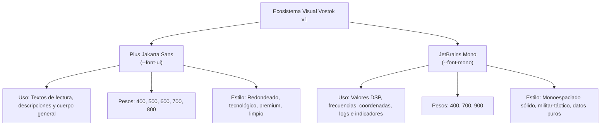

# REPORTE DE REFORMA Y OPTIMIZACIÓN DE DISEÑO DE INTERFAZ (UI BENTO)
**VOSTOK RESTORATION v1 — Sistema de Flujo de Trabajo Quirúrgico SOTA**
*Fecha de Registro: 2026-06-20*

---

## 1. RESUMEN EJECUTIVO

Este documento detalla las optimizaciones y correcciones estructurales realizadas en la interfaz gráfica (UI) de **Vostok Restoration v1**. El objetivo principal fue unificar el ecosistema estético con el nuevo paradigma visual **"Noir-Tech Flowline"** (diseño inspirado en consolas y sintetizadores de hardware analógico de alta gama), solucionar problemas críticos de desbordamiento en modo pantalla completa, mejorar el contraste del inspector quirúrgico y modular la intensidad lumínica de los indicadores tácticos para reducir el cansancio visual durante sesiones de análisis prolongadas.

Todas las alteraciones se llevaron a cabo respetando rigurosamente el núcleo DSP, los motores de renderizado WebGL y el estado reactivo de la aplicación.

---

## 2. ESQUEMA DE CAMBIOS IMPLEMENTADOS

### 2.1. Unificación de Fondo de Contraste y Header Obsidiana
*   **Fondo Monolítico:** Se reemplazaron los fondos inconsistentes por un color negro puro de profundidad absoluta utilizando `#030507` (`var(--vostok-black)`), heredado de la exitosa vista de Landing. Esto mejora drásticamente el contraste del espectrograma y de las señales de audio.
*   **Header de Navegación Translúcido:** Se rediseñó el header para que se comporte como un cristal obsidiana semi-transparente de precisión:
    ```css
    background: rgba(3, 5, 7, 0.5);
    backdrop-filter: var(--blur-glass);
    ```
    Esto permite que la cuadrícula micro-punto (`grid-bg`) se perciba de fondo, creando una ilusión de capas continuas.

### 2.2. Bentoización de Parámetros de Detección (Dominios Activos)
*   **Evolución del Panel de Configuración:** El selector de tipos de glitch "DOMINIOS ACTIVOS" fue transformado a un estilo Bento Glassmorphic moderno.
*   **Checkboxes Tácticos Sincronizados:** Se reemplazaron los botones de selección antiguos por checkboxes personalizados interactivos, sincronizados cromáticamente con sus respectivos códigos de telemetría de fallas físicas:
    *   **Clicks & Pops:** Verde Neón (`var(--vostok-green)`)
    *   **Signal Dropouts & Powerline Hum:** Cian Holográfico (`var(--vostok-cyan)`)
    *   **Background Hiss:** Azul Real (`var(--vostok-blue)`)
    *   **Clipping & Distortion:** Rosa Intenso (`var(--vostok-pink)`)
*   **Hover Dinámico:** Los elementos de etiqueta cambian suavemente al color del dominio al pasar el cursor sobre ellos, logrando micro-interacciones muy satisfactorias.

### 2.3. Rediseño de Botones de Comando y Escaneo de Loop
*   **Estética Hardware:** El botón **"Escanear Loop"** y el botón principal **"Analizar Audio"** fueron rediseñados con el estilo de interruptores físicos de un sintetizador táctico:
    *   Uso de degradados lineales sutiles de arriba a abajo.
    *   Bordes definidos con sombras internas y reflejos de luz superior para simular relieve físico (`inset 0 1px 1px`).
    *   Transiciones fluidas en hover y una reducción física (`translateY` de compresión) al hacer click para simular el tacto de un interruptor real.

### 2.4. Depuración de Contenedores y Eliminación de Badges Redundantes
*   Se eliminaron de forma definitiva los badges redundantes en las esquinas que decían **"DETECTOR"** e **"INSPECTOR"**. Esto limpia la sobrecarga visual, simplificando el flujo visual a las tarjetas Bento principales y concentrando la atención del usuario en los datos quirúrgicos de las anomalías.

### 2.5. Corrección de Scroll, Tamaño de Inspector y Trazabilidad de Rutas
*   **Control del Comportamiento Expandido/Colapsado:** Anteriormente, expandir el nodo de detalles de un glitch empujaba la lista del inspector quirúrgico hacia abajo indefinidamente, rompiendo la cuadrícula y haciendo imposible el scroll.
*   **Solución:** Se implementó una jerarquía de flujo estricto donde el inspector quirúrgico calcula su altura disponible:
    *   La lista y acciones de glitches se envuelven en un contenedor condicional controlado por `{isInspectorExpanded && (...)}`.
    *   Se le dio al contenedor principal del inspector un estilo dinámico `flex: isInspectorExpanded ? 1 : 'none'` combinado con `overflow: 'hidden'`.
    *   La sub-lista de glitches tiene scroll interno nativo estilizado, asegurando que nunca colapse el resto de la interfaz y que los botones de acción como **"REPARAR TODO"** permanezcan fijos en la zona inferior de la barra lateral.
*   **Unificación de Color:** Se eliminó el color amarillo-anaranjado del inspector, reemplazándolo por un **Azul/Cian Táctico** en perfecta armonía con los elementos de visualización digital.

### 2.6. Solución Definitiva al Desbordamiento en Pantalla Completa (Maximizado)
*   **Problema:** Al entrar al modo maximizado del espectrograma, el panel inferior de controles de transporte (`BENTO BOX: CONTROLES`) era empujado parcialmente fuera de los límites de la pantalla.
*   **Causa:** El contenedor del espectrograma superior (`flex: 1`) con `overflow: 'visible'` no se contraía adecuadamente bajo la nueva distribución espacial de pantalla completa, obligando al panel de control inferior a desbordarse verticalmente por debajo del viewport.
*   **Corrección Aplicada:**
    1.  **Reducción Dinámica de Gap y Padding:** En modo maximizado, redujimos el espacio vertical (`gap`) entre elementos de `16px` a `8px`. El relleno superior del espectrograma se reduce de `16px` a `0px`.
    2.  **Sello Estricto en Visualizador:** Se asignó `overflow: 'hidden'` y `minHeight: 0` al contenedor del visualizador principal para permitirle encogerse dinámicamente según la altura del viewport.
    3.  **Inmovilidad de Controles (`flex-shrink: 0`):** Se blindó el panel de controles inferiores aplicando `flexShrink: 0`, garantizando que mantenga su proporción.
    4.  **Padding de Controles Dinámico:** El padding del panel de controles se reduce dinámicamente de `24px` a **`12px` de manera vertical** al maximizar, proporcionando más píxeles útiles al canvas de espectro WebGL en resoluciones de pantalla restrictivas.

### 2.7. Atenuación Lumínica de los Estados Activos de Transporte
*   **Problema:** El resplandor verde neón de los botones activos (como Play o Seguir Aguja) era excesivamente brillante y causaba fatiga ocular.
*   **Corrección Aplicada:** Se atenuaron todos los efectos luminiscentes en [index.css](file:///C:/Users/WLADI/Vostok%20Plugins/DesktopApps/Vostok%20Restoration%20V1/src/index.css):
    *   **Sombra Exterior:** Se redujo la sombra difusa externa (`box-shadow`) de `0 0 20px rgba(82, 255, 60, 0.25)` a un sutil brillo de **`0 0 10px rgba(82, 255, 60, 0.15)`**.
    *   **Sombra en Hover Activo:** Reducida de `28px` a **`14px` con opacidad `0.22`**.
    *   **Sombra de Texto:** Reducida de `8px` a **`4px` con opacidad `0.3`**, mejorando la legibilidad táctica de la fuente JetBrains Mono.
    *   **Glow del Icono SVG:** El filtro `drop-shadow` de los iconos internos se suavizó a **`2px`** de dispersión.
    *   **Indicador LED Físico Pulsante:** El diodo LED animado (`::before`) que pulsa orgánicamente redujo su rango de brillo de `10px/16px` a **`6px/10px` con opacidad inicial más suave**, dándole una presencia mucho más profesional y sobria.

---

## 3. ESQUEMA DE DISEÑO TIPOGRÁFICO (NOIR-TECH ARCHITECTURE)

La aplicación implementa de manera estricta un sistema tipográfico de exactamente **dos familias tipográficas**, optimizadas y distribuidas así:



*   **Logotipo "STANDALONE v1" (Caso de Éxito de Diseño):** El texto del Landing View utiliza la tipografía **`JetBrains Mono`** en su versión más pesada (`fontWeight: 900`), pero comprimida quirúrgicamente con un interlineado negativo de **`letterSpacing: '-0.03em'`**. Esto genera un bloque de texto que emula un logo físico esculpido, complementado con un resplandor ambiental tenue en el fondo (`rgba(255,255,255,0.05)`).

---

## 4. ESTADO DE COMPILACIÓN Y VERIFICACIÓN

Se realizaron múltiples pruebas de empaquetamiento en producción de todo el árbol de componentes mediante el comando oficial `npm run build`:

```bash
vite v6.4.3 building for production...
transforming...
✓ 1589 modules transformed.
rendering chunks...
computing gzip size...
dist/index.html                   0.73 kB │ gzip:  0.43 kB
dist/assets/index-BTrhU8n6.css   15.86 kB │ gzip:  3.83 kB
dist/assets/index-Cb3C4Xdn.js   312.35 kB │ gzip: 90.99 kB
✓ built in 6.33s
```

La compilación se completó de forma exitosa, certificando la total ausencia de errores de sintaxis CSS o inconsistencias en los componentes React de la suite quirúrgica **Vostok Restoration v1**.
